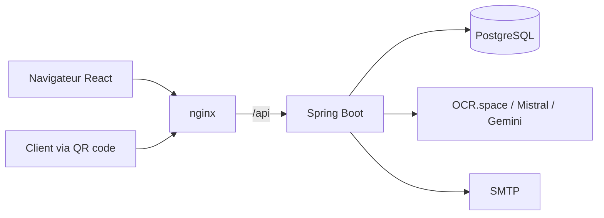

# InkScribe AI

Plateforme d'analyse d'avis clients : lecture d'avis **manuscrits** par OCR, analyse de sentiment, thèmes et mots-clés par IA, collecte par **QR code** et tableau de bord.

## Sommaire

- [Fonctionnalités](#fonctionnalités)
- [Architecture](#architecture)
- [Structure du projet](#structure-du-projet)
- [Démarrage rapide](#démarrage-rapide)
- [Configuration](#configuration)
- [Développement](#développement)
- [Déploiement en production](#déploiement-en-production)
- [Sécurité](#sécurité)
- [Tests et CI](#tests-et-ci)
- [Limites connues et pistes](#limites-connues-et-pistes)

## Fonctionnalités

- **Import d'avis manuscrits** : photos, capture caméra ou PDF multi-pages, puis OCR (OCR.space, Mistral, Gemini) et analyse IA.
- **Collecte par QR code** : un formulaire public par établissement, analysé automatiquement à la soumission.
- **Analyse** : sentiment, thèmes, mots-clés positifs et négatifs, réponse client suggérée.
- **Tableau de bord** : tendances, alertes sur le taux d'avis négatifs, détection de doublons, filtres.
- **Digest hebdomadaire** envoyé par e-mail par le backend (chaque lundi à 8h, fuseau Africa/Tunis).
- **Import / export** CSV et JSON, comptes multi-établissements.

## Architecture



| Couche | Technologies |
|---|---|
| Frontend | React 19, TypeScript, Vite, Material Web, pdf.js, transformers.js |
| Backend | Java 21, Spring Boot 4, Spring Security, JPA |
| Données | PostgreSQL 16 (jsonb pour listes et objets) |
| Déploiement | Docker Compose, nginx, Caddy (HTTPS, en amont) |

## Structure du projet

```
.
├── backend/                  API Spring Boot
│   └── src/main/java/com/inkscribe/backend/
│       ├── AuthController        inscription, connexion, 2FA, reset mot de passe
│       ├── ApiController         avis, établissements, formulaire public
│       ├── AiController / AiService   OCR et analyse IA
│       ├── DigestService         digest hebdomadaire
│       ├── SecurityConfig, RateLimitFilter
│       └── CryptoService, Totp, KeyStore
├── frontend/                 SPA React (Vite)
│   └── src/pages/            Analyzer, Overview, Analytics, FeedbackTable, Settings, …
├── docker-compose.yml        stack locale (db + backend + web)
├── docker-compose.prod.yml   stack de production
└── .github/workflows/ci.yml  tests backend, build frontend, build Docker
```

## Démarrage rapide

Prérequis : Docker et Docker Compose.

```bash
git clone https://github.com/omrani-wiem/Inscribe.git
cd Inscribe
cp .env.example .env      # puis remplir les secrets (voir ci-dessous)
docker compose up --build
```

Ouvrir <http://localhost:8081>.

Sans SMTP configuré, les codes envoyés par e-mail (vérification, réinitialisation) s'affichent dans les logs :

```bash
docker compose logs backend
```

## Configuration

Les variables se définissent dans `.env` à la racine :

| Variable | Rôle |
|---|---|
| `DB_PASSWORD` | Mot de passe PostgreSQL |
| `JWT_SECRET` | Secret de signature des jetons JWT (HS256), long et aléatoire |
| `ENC_KEY` | Clé de chiffrement AES-256-GCM (secret 2FA, clés API des services IA) |
| `MAIL_USER`, `MAIL_PASSWORD` | Identifiants SMTP |
| `MAIL_ENABLED`, `MAIL_HOST`, `MAIL_PORT`, `MAIL_FROM` | Options SMTP (par défaut : désactivé, `smtp.resend.com:587`) |
| `DOMAIN` | Nom de domaine (utilisé en production pour CORS) |

Générer des secrets robustes :

```bash
openssl rand -base64 48   # JWT_SECRET
openssl rand -base64 32   # ENC_KEY
```

Les clés des services IA (OCR.space, Mistral, Gemini) se saisissent depuis l'interface, dans les paramètres. Elles sont stockées chiffrées et jamais renvoyées au navigateur.

> Ne commitez jamais votre fichier `.env`. Changez `ENC_KEY` et `JWT_SECRET` avant tout déploiement : la valeur de développement par défaut n'est pas sûre.

## Développement

Backend (nécessite une base PostgreSQL accessible) :

```bash
cd backend
cp src/main/resources/application.properties.example src/main/resources/application.properties
./mvnw spring-boot:run
```

Frontend :

```bash
cd frontend
npm ci
npm run dev
```

Build de production du frontend : `npm run build`.

## Déploiement en production

```bash
docker compose -f docker-compose.prod.yml up -d --build
```

Cette configuration restreint CORS à `https://${DOMAIN}`. Prévoir un reverse proxy HTTPS (par exemple Caddy) devant le conteneur `web`, exposé sur le port 8081.

## Sécurité

- Mots de passe hachés avec BCrypt, jetons JWT signés (HS256), API stateless.
- Vérification d'e-mail, réinitialisation de mot de passe par code à usage unique.
- 2FA TOTP (RFC 6238), secret chiffré en base, code non rejouable.
- Blocage du compte après 5 échecs, limitation de débit par IP.
- Clés API des services IA chiffrées (AES-256-GCM), jamais renvoyées au navigateur.
- Isolation stricte des données entre comptes, vérifiée par des tests.

## Tests et CI

```bash
cd backend && ./mvnw test
```

- **Unitaires** : TOTP contre les vecteurs officiels de la RFC 6238, chiffrement, limitation de débit.
- **Intégration** sur un vrai PostgreSQL : inscription, vérification d'e-mail, blocage, isolation des comptes, 2FA, formulaire public, chiffrement des clés.

GitHub Actions exécute à chaque push sur `main` et chaque pull request : les tests backend (avec PostgreSQL 16), le build du frontend (Node 22) et le build des images Docker.

## Limites connues et pistes

- Schéma géré par Hibernate (`ddl-auto=update`) : passer à Flyway.
- Images stockées en base64 dans la table : à déplacer vers un stockage objet.
- Pas de pagination de la liste d'avis ; limitation de débit en mémoire (non partagée entre instances).
- Pas de codes de secours 2FA.
- Prévu : évaluation chiffrée de la qualité des OCR.
